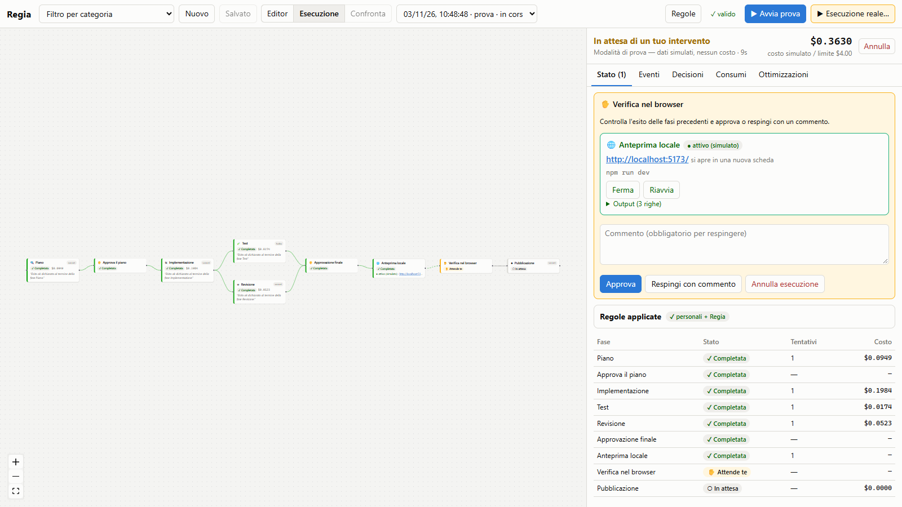

# Regia

Disegna il percorso, lascia lavorare gli agenti, intervieni quando serve.

Regia è un'applicazione locale per progettare graficamente workflow di sviluppo eseguiti da agenti del [Claude Agent SDK](https://docs.claude.com/en/docs/agent-sdk/overview) e seguirne l'esecuzione in tempo reale sullo stesso diagramma.



## Cosa fa

- **Editor grafico**: fasi di analisi, implementazione, test, revisione, approvazione umana, server locale e pubblicazione, collegate tra loro. Si parte da preset pronti.
- **Esecuzione in tempo reale**: stato di ogni fase sul diagramma, eventi, risultati, errori e decisioni dichiarate dagli agenti.
- **Interventi**: approvazioni, correzioni con commento (l'agente riprende dalla sua sessione), riprova, salta, annulla.
- **Anteprima locale**: Regia avvia il server di sviluppo del progetto con la versione di Node giusta e ti dà il link da verificare prima di approvare.
- **Consumi**: token, cache, modello e costo stimato per esecuzione, fase e agente, senza doppi conteggi su subagenti e sessioni riprese. Limite di spesa per esecuzione e per fase.
- **Ottimizzazione**: suggerimenti basati sui dati misurati, con il compromesso sulla qualità, e confronto tra due esecuzioni.
- **Continua**: aggiungi fasi a un lavoro già fatto senza rieseguire tutto.
- **Regole generali**: le tue regole personali e quelle di Regia vengono applicate a ogni agente.
- **Modalità di prova**: esplora tutto con agenti simulati, senza costi.

## Avvio rapido

Requisiti: Node.js 20+. Per le esecuzioni reali, Claude Code con login attivo oppure `ANTHROPIC_API_KEY`.

```bash
git clone https://github.com/DoctorB/regia.git
cd regia
npm install
npm start
```

Apri <http://127.0.0.1:4317>, crea un workflow da un preset e premi **▶ Avvia prova**.

## Documentazione

- [Manuale](docs/manuale.md): come si usa, passo per passo, con immagini.
- [Dettagli tecnici](docs/dettagli-tecnici.md): conteggio dei consumi, regole, permessi degli agenti, dati salvati, variabili d'ambiente, limiti noti.

## Costi e dati

- I costi mostrati sono **stime** calcolate dal SDK, non dati di fatturazione. Con una chiave API il costo effettivo si legge nella Console; con il login claude.ai il consumo rientra nei limiti del piano.
- Tutto resta sul tuo computer, nella cartella `data/` (esclusa da git). Regia non legge né salva credenziali e ascolta solo su 127.0.0.1.
- Gli agenti possono modificare file ed eseguire comandi nella cartella del progetto, con i soli strumenti che concedi a ogni fase. Usa un repository git pulito per poter rivedere e annullare.

## Sviluppo

```bash
npm run dev        # server e interfaccia con ricaricamento automatico (http://127.0.0.1:5173)
npm test           # contabilità, motore di esecuzione, server locale
npm run typecheck
```
