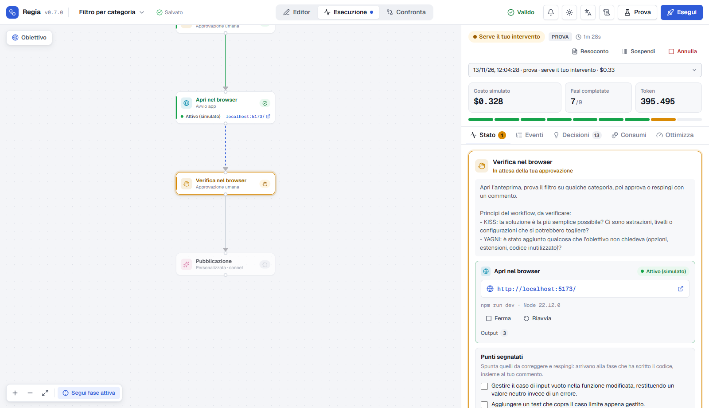

# Regia

Draw the path, let the agents work, step in when it matters.

Regia is a local app for designing development workflows as a diagram, running them with [Claude Agent SDK](https://docs.claude.com/en/docs/agent-sdk/overview) agents, and following the execution live on the same diagram.



> The interface is available in English and Italian (switch it from the languages menu at the top right). The documentation is available in [English](docs/manual.md) and [Italian](docs/manuale.md).

## What it does

- **Visual editor**: analysis, implementation, test, review, human approval, run app and publishing phases, connected into a flow. Start from ready-made presets. Each agent phase says in plain words what it can do (read only, change the project, also internet); individual tools, skills, turn limit and context are tucked away under Advanced, with recommended values per phase type.
- **Live execution**: the state of every phase on the diagram, plus events, results, errors and the decisions declared by the agents.
- **Interventions**: approve, reject with a comment (the agent resumes its own session), retry, skip, cancel. Review phases list the fixes they propose as points: at approval you tick the ones to apply and add your own instructions. You can also ask an earlier phase a question at approval: it answers without changing anything. A phase that stops because it lacks a permission, or needs a folder outside the project, can be granted it with one click, and the saved workflow is updated too. A short sound tells you when a phase needs you and when the run ends.
- **See the result on phone, browser or desktop**: ready-made phases detect the project and show it with nothing to configure: they install the APK or iOS app on the connected phone, start the site (with its backend) and open it in Chrome or another browser, or launch the desktop app.
- **Acceptance test on phone**: one phase builds and installs the app on the connected Android phone, then an agent tries it on the scenarios of the change while Regia follows the app log; you watch the phone screen live inside Regia; anomalies (crashes included) come back to the approval as points to fix, with screenshots, and the test repeats after the fix.
- **Check the app before approving**: web, desktop or mobile, iOS included on a Mac. Regia runs the project's own command (npm, dotnet, flutter, gradle, msbuild…) and waits for an address, an output line, an open window or a successful exit; it can also just check a site already served by IIS. For Node projects it also picks the right Node version.
- **Usage tracking**: tokens, cache, model and estimated cost per run, phase and agent, with no double counting across subagents and resumed sessions.
- **Optimization**: suggestions based on measured data, each with its quality trade-off, and a side-by-side comparison of two runs.
- **Run report**: a Markdown summary of the run (results, decisions, files edited, interventions, costs), to copy into a pull request or download.
- **Continue**: add phases to finished work without re-running everything.
- **Sync a feature with develop**: a dedicated preset merges develop into the feature branch, resolves conflicts, repeats tests and review and prepares the checklist for your functional test, using the feature's run as reference.
- **Suspend and resume**: stop a long run in the evening and resume it the next day, even after shutting down the PC. Interrupted phases pick up where they were, on the same agent session while the prompt cache is still valid, otherwise from a summary of the work already done.
- **General rules**: your personal rules and Regia's own rules are applied to every agent.
- **Design principles**: turn on KISS, YAGNI, DRY or SOLID for a workflow; each phase gets guidance suited to its task and approvals get a checklist, without touching your instructions.
- **Additional folders**: besides the project, phases can read and write in folders you list in the workflow, such as another repository or a shared output folder; every other folder stays off limits.
- **Skills**: phases can use the skills of the project (`.claude/skills`, or `.agents/skills` shared with other coding tools) or your personal ones, chosen per phase.
- **Trial mode**: explore everything with simulated agents, at no cost.
- **Update notice**: the version in use is shown in the interface, with a notice when a newer one is on GitHub (update with `git pull`).
- **Languages**: Italian and English included; interface, messages and agent instructions come from JSON files, so a new language needs no code changes.

## Quick start

Runs on Windows, macOS and Linux (iOS apps need a Mac with Xcode). Requirements: Node.js 20+. For real runs, Claude Code with an active login, or `ANTHROPIC_API_KEY`.

```bash
git clone https://github.com/DoctorB/regia.git
cd regia
npm install
npm start
```

Open <http://127.0.0.1:4317>, create a workflow from a preset and press **Prova** (trial run).

## Documentation

| | English | Italiano |
|---|---|---|
| User manual, step by step with screenshots | [Manual](docs/manual.md) | [Manuale](docs/manuale.md) |
| Usage accounting, rules, agent permissions, stored data, environment variables, known limits | [Technical details](docs/technical-details.md) | [Dettagli tecnici](docs/dettagli-tecnici.md) |

## Costs and data

- Costs shown are **estimates** computed by the SDK, not billing data. With an API key, the actual cost is in the Console; with a claude.ai login, usage counts against your plan limits.
- Everything stays on your machine, in the `data/` folder (excluded from git). Regia never reads or stores credentials and listens on 127.0.0.1 only.
- Agents can edit files and run commands in the project folder, limited to what you allow each phase. Use a clean git repository so you can review and undo their work.

## Development

```bash
npm run dev        # server and UI with hot reload (http://127.0.0.1:5173)
npm test           # usage accounting, execution engine, Run app phase
npm run typecheck
```

## License

[MIT](LICENSE)
