# Regia manual

*[Leggi in italiano](manuale.md)*

Regia lets AI agents work on your project along a path you design: analysis, implementation, testing, review, browser preview, approval, publishing. While they work, the diagram shows what they are doing, what they decide and how much they use, and you step in when needed.

The interface is available in English and Italian: switch it from the languages menu at the top right. This manual uses the English labels; the screenshots show the Italian interface, taken in **dry-run mode** (simulated agents, no cost). Each workflow also has an **agent language** (settings → Run), which sets the language of the instructions sent to the agents.

---

## 1. Start

Once:

```bash
git clone https://github.com/DoctorB/regia.git
cd regia
npm install
```

Every time:

```bash
npm start
```

Open **http://127.0.0.1:4317** and keep the terminal open while you use Regia. Closing it also stops any run in progress.

**Systems**: Windows, macOS and Linux. iOS apps need a Mac with Xcode (see [iOS apps on a Mac](#ios-apps-on-a-mac)).

**Requirements**: Node.js 20 or later. Real runs need [Claude Code](https://docs.claude.com/en/docs/claude-code) with an active login (check with `claude auth status`), or the `ANTHROPIC_API_KEY` environment variable. You don't need to open Claude Code: Regia uses its credentials.

**Updates**: the version in use is shown next to the Regia name, at the top left. When a newer one is published on the GitHub repository, a notice appears in its place (`v0.1.0 → v0.2.0`): click it to see the commands to update. Updating is manual, from the Regia folder:

```bash
git pull
npm install
```

then restart with `npm start`. The check only reads the published version number and can be turned off with `REGIA_UPDATE_CHECK=0`.

---

## 2. Create a workflow

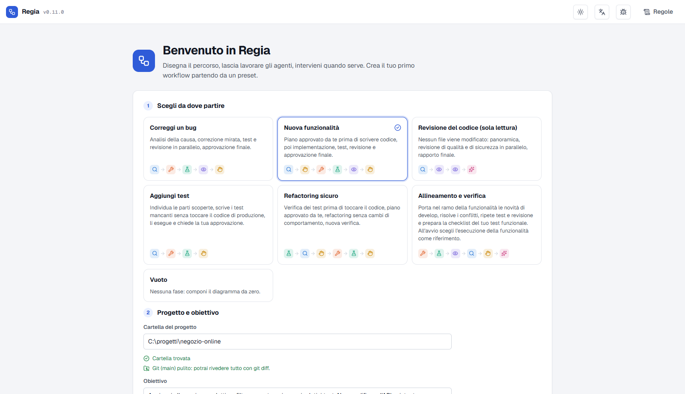

1. On first start you see the welcome screen; later, open the menu with the workflow name at the top left → **New workflow…**. Pick a preset: *Fix a bug*, *New feature*, *Code review (read-only)*, *Add tests*, *Safe refactoring*, *Sync and verify* or *Empty*.
2. Enter the **project folder**. Regia checks whether it is a git repository and whether it has uncommitted changes.
   > Before a real run, **commit or stash** your changes: you can then review the agents' work with `git diff` and undo it with `git checkout .`.

   If phases must also read or write outside the project (another repository, a shared output folder), add those folders under **Additional folders** in the workflow settings. Every other folder stays off limits.
3. Write the **goal**: what needs to be done and when it counts as finished. The more precise it is, the fewer rounds it takes.
4. Optional: turn on one or more **design principles** (KISS, YAGNI, DRY, SOLID). See [Design principles](#design-principles).

---

## 3. Customize the phases

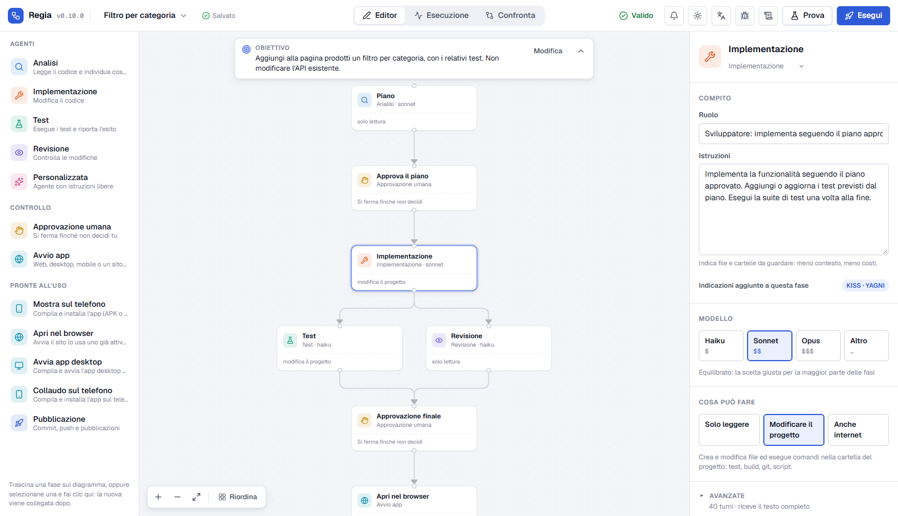

- **Add** phases from the palette on the left: drag them onto the diagram, or click. If a phase is selected, the new one is connected right after it. **Arrange** lays the diagram out top to bottom.
- **Connect** two phases by dragging from the bottom handle of one to the top handle of the other. To **move** a connection drag one of its ends onto another phase (dropped on empty space it is deleted). To **delete** it right-click it and choose *Delete connection*, or select it and press **Delete** (this also works for a phase).
- The workflow **goal** stays visible at the top of the diagram: click to read it in full, **Edit** to change it. You can shrink it to a button; during a run it starts shrunk, so it does not cover the phases.
- **Configure** the selected phase in the right panel:
  - *Instructions*: what it must do, ideally naming the files to look at.
  - *Model*: Haiku ($) for simple tasks (tests, checks), Sonnet ($$) as the balanced choice, Opus ($$$) for the hardest tasks.
  - *What it can do*: **Read only**, **Change the project** (creates and edits files, runs commands such as tests, builds, git and scripts) or **Also internet**. New phases start with the choice that fits their type: analysis and review read, implementation and custom phases change the project. Individual tools are under **Advanced** for those who want to pick them by hand.
  - *Advanced*, collapsed: individual tools, skills, max turns (a safety cap), what the phase receives from earlier phases and result reuse. Each phase type already has recommended values; when collapsed, the section lists only what differs from them, and **Back to recommended values** restores them.
- On the diagram each agent phase shows what it can do (*read only*, *changes the project*, *also internet*).
- With no phase selected, the panel shows the **workflow settings**: folder, goal, phases in parallel, rules.
- The indicator at the top tells you whether the workflow is **Valid**: click it to see errors and warnings and jump to the phase concerned. Errors block the start. **Save** appears when there are changes (also `Ctrl+S`).

### Phase types

| Phase | Purpose |
|---|---|
| Analysis, Implementation, Test, Review, Custom | Work done by an agent |
| **Human approval** | The workflow waits until you approve or reject |
| **Run app** | Regia starts the app so you can check it: web, desktop, mobile, or it checks a site already served by IIS |
| **Acceptance test on phone** (ready-made phase) | Builds and installs the app on the phone, tries it on the change's scenarios while following the log and reports anomalies |
| **Publishing** (ready-made phase) | Commit, push and any releases or GitHub Actions. Place it after an approval |

---

## 4. Try first, then run for real

- **Dry run**: runs everything with simulated agents. Use it to check the flow and the interactions, for free.
- **Run**: a real run. It shows a summary (authentication, models, phases that can edit files, local commands) and starts only after you confirm.

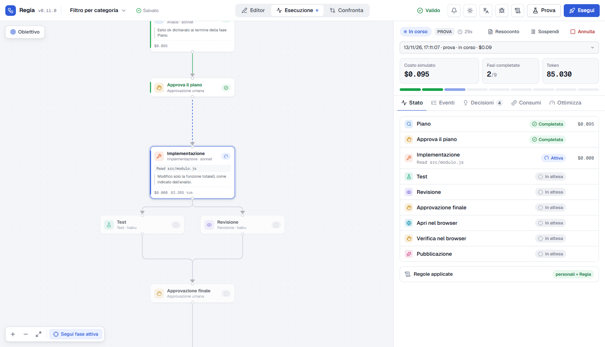

On the diagram each phase shows its state (waiting, active, completed, failed, blocked, waiting for you), what it is doing and the last declared decision; **Follow active phase** keeps the running phase in view. At the top of the panel you find the cost, completed phases and a progress bar (click a segment to select that phase). **Cancel** stops everything.

---

## 5. Step in when needed

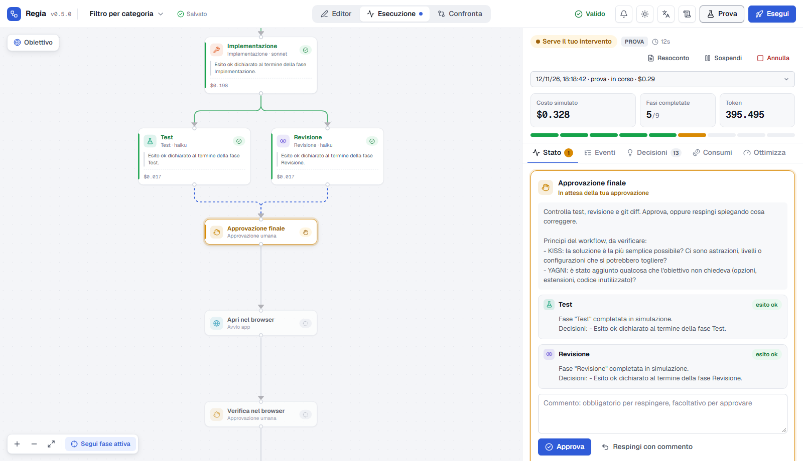

When the workflow stops, the **Status** tab shows what is needed:

- **Approval**: read the summaries of the previous phases and check the project (`git diff`), then **Approve** or **Reject with comment**: the phase that produced the work resumes where it left off with your comment, and tests and review run again.
  When a review finds something to fix it still turns green: its task was to check. The points it proposes appear in the approval as **Points reported**, one per checkbox. Tick the ones to correct, optionally add your own instructions for refinements the review cannot judge, and reject: the chosen points and your comment go together to the phase that wrote the code. If you approve with points ticked, Regia asks you to confirm.
  If something is unclear, open **Ask a question** in the same card: pick the phase to ask (usually the review) and write the question. The phase answers right there, without changing files, while the approval keeps waiting; you can ask follow-up questions and the conversation continues. Then decide whether to approve or reject. Each question costs a short agent turn, included in the usage; questions and answers go into the run report.

  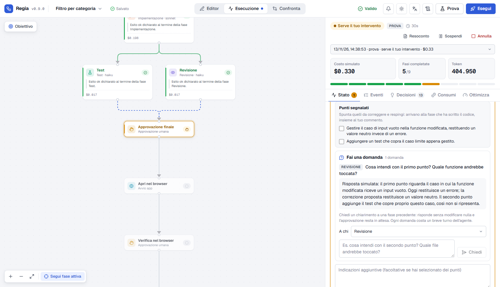

- **Failed or blocked phase**: **Retry from scratch**, **Resume session** (with a message for the agent), **Skip phase** or **Cancel run**.
  If the phase stopped because it lacked permission for what it needed (for example running a script or creating a file in a read-only phase), **Allow changes and resume** also appears: the phase resumes the same session with the new permission, and the saved workflow is updated so the next run starts that way.
  Likewise, if the phase stopped because it had to work in a folder outside the project, **Allow <folder> and resume** appears: the folder is added to the workflow's additional folders, the saved workflow included, and the phase resumes the same session.

When a phase starts waiting for you, and when the run ends, Regia plays a short sound, even while you are in the editor. Turn it on or off with the bell button at the top right; the choice is remembered.

### Suspend and resume the next day

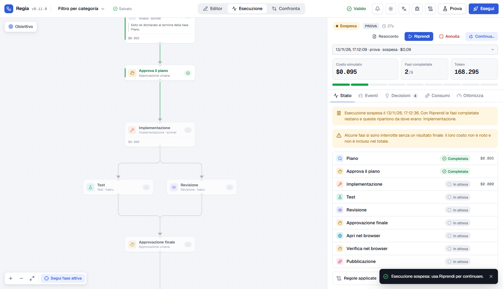

A long piece of work does not have to finish the same day:

1. Press **Suspend** at the top of the run panel. Running phases stop and their work stays recorded, apps started by Regia are closed, and pending approvals and interventions stay where they are.
2. You can close Regia and shut down the PC. If you shut it down without suspending, after restarting the run shows as **Interrupted** and resumes the same way.
3. The next day, open the run and press **Resume**. Completed phases are kept, phases stopped halfway pick up where they were, apps are restarted and approvals are available again.

Regia decides how an interrupted phase restarts. If the last activity is recent (within the prompt cache lifetime, 5 minutes) it resumes the same agent session. Otherwise it opens a new session with a summary of the steps already done, instead of sending the whole previous conversation again. The event log says which one it chose and why.

If the project has changed branch or commit in the meantime (a pull, a checkout), Regia tells you before resuming and asks for confirmation.

### Checking the app: web, desktop, mobile

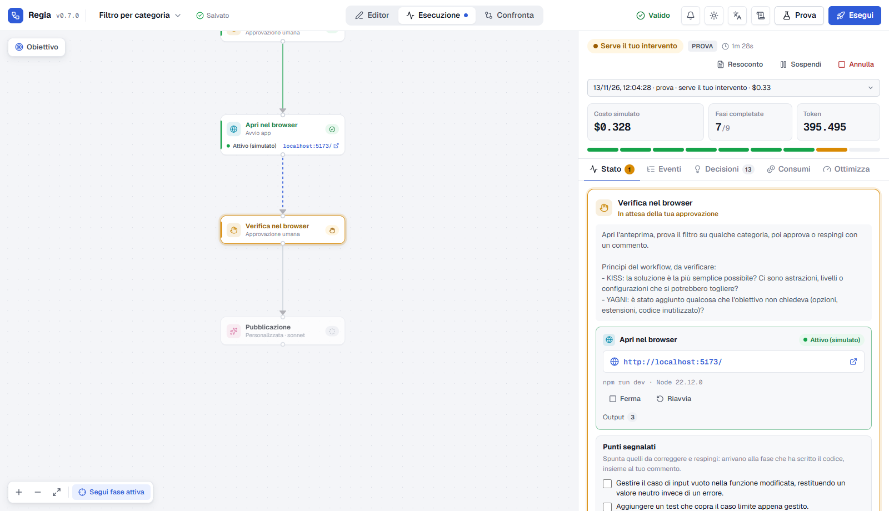

Regia is not tied to a technology: agents work with the project's own tools (npm, dotnet, msbuild, gradle, flutter, Xcode, docker…) through the Bash tool. The **Run app** phase lets you see the result before approving. It runs any command in the project folder and waits until the app is ready, according to the criterion chosen in **Ready when**:

| Criterion | Examples |
|---|---|
| **An address responds** | Web dev server (`npm run dev`, `dotnet watch`), API, container. **With no command** it only checks a site that is already running, for example on **IIS**: Regia neither starts nor stops it |
| **A text appears in the output** | Mobile app on an emulator or device (`flutter run` → "Flutter run key commands"), build in watch mode |
| **The program stays open** | Desktop app (`dotnet run`, `npm run electron`, `python app.py`): the window stays open until you approve |
| **The command succeeds** | Build, install on a device (`gradlew installDebug`), iOS app in the simulator (`xcodebuild` + `xcrun simctl`), local deploy to IIS (`msdeploy`, PowerShell script) |

In the palette, among the **ready to use** phases, you'll find **Show on phone**, **Open in browser** and **Launch desktop app**: they ask for nothing, Regia detects the project by itself (see below). For a special case, start from a **Run app** phase and pick command and criterion yourself.

The approval request shows the link (if any), the status, the last output lines and the Stop / Restart buttons. The app is closed when the run ends; after a correction requested in an approval it is restarted, so you check the updated version.

For Node projects (with a `package.json`) Regia does more: it picks the required Node version (`.nvmrc`, `engines`), installs dependencies if missing and, if the right version is not installed, offers to install it.

### Showing the result: phone, browser, desktop

Three ready-made phases let you see the result at a precise point of the workflow, usually after implementation and review and before an **Approval**: you try it and decide. There is nothing to configure. When the phase starts, Regia detects the project in the workflow folder (or one of its direct subfolders), builds the right command and waits until it is ready.

| Ready-made phase | What it does | Detected projects |
|---|---|---|
| **Show on phone** | Builds the app (APK or iOS), installs it on the connected phone and opens it | Flutter, React Native, Expo, Capacitor, Android with Gradle (Kotlin Multiplatform included) |
| **Open in browser** | Starts the site and opens the page in the browser as soon as it responds; the site stays up until the run ends | Node with a `dev` or `start` script (Vite, Next.js, Angular, Astro, Nuxt, SvelteKit…), ASP.NET Core, Blazor, Flutter web, Django, Laravel, Rails, static pages with `index.html` |
| **Launch desktop app** | Builds and launches the app; the window stays open until you approve | Electron, Tauri, .NET (WPF, Windows Forms, WinUI, Avalonia, MAUI), Flutter desktop, Compose Desktop |

The phase panel shows right away what was detected (project, device, command) and, if something is missing, what to do. All choices are optional:

- **Phone**: Regia finds Android phones connected over USB (through the Android SDK's `adb`) and, on a Mac, iPhones; it prefers a real phone to an emulator. You can pick a specific device, the platform and the build. The default build is the one that works on its own on the phone: release for Flutter, React Native and Expo (no Metro needed), debug for Capacitor and Android with Gradle. If the phone is not connected or has not authorized the computer, the phase stops and tells you what to do; then **Retry**.
- **Browser**: pick the browser (Chrome, Edge, Firefox, Safari or the default one) and, if needed, the address to open, for example an inner page. If the project has frontend and backend in separate folders (e.g. `fe` and `be`), Regia opens the frontend and starts the backend along with it, stopping it with the phase; you can turn this off. For a site already running, for example on **IIS**, choose **A site already running** and enter the address: Regia checks it and opens it without starting anything.
- **Desktop**: nothing to choose.

Under **More options** you can set a subfolder, change the maximum wait or switch to a **custom command**, starting from the detected one.

### Acceptance test on phone

**Acceptance test on phone**, among the ready-made phases, does in a single node what you would do to try a change on the phone:

1. **Builds, installs and opens the app** like **Show on phone**, with the same device and build choices. This part uses no agent and costs nothing.
2. **Follows the app log** for the whole test (on Android, with `logcat`): the app's warnings, errors, crashes and ANRs. A crash shows up in the events right away and becomes an anomaly even if the agent misses it.
3. **Tests**: an agent derives the scenarios from the goal, the previous phases and `git diff`, runs them on the app like a user (reads the screen, taps, types, scrolls), saves screenshots at the key moments and rereads the log after each scenario.
4. **Reports the anomalies**: each with steps, expected and actual result and screenshot. Scenarios that cannot be tried automatically (Bluetooth, NFC, biometrics, payments) go under **To try by hand**.

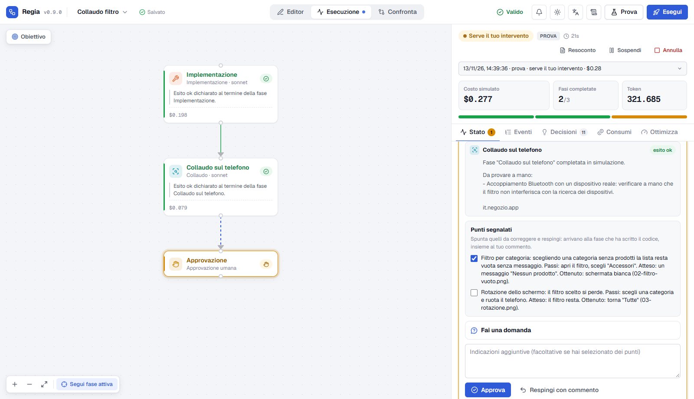

The anomalies reach the next approval as **Points reported**, like the review's: tick the ones to fix and reject, the phase that wrote the code fixes them and the test runs again, build included. In the **Status** tab the test card shows device, anomalies, log summary (with the full file) and thumbnails of the screenshots of each round.

The agent does not change the code and performs no irreversible actions (purchases, real sends, deleting data). If test credentials are needed, write them in the phase instructions; for now the automated test is for Android.

### iOS apps on a Mac

On a Mac with **Xcode** (and its command line tools: `xcode-select --install`) Regia also orchestrates iOS apps: Regia is installed and started just as on Windows.

- **Agents**: they build and run tests with `xcodebuild` through Bash: set the phases that need it to **Change the project**. Builds are slow: raise the maximum turns of those phases.
- **Show on phone** also works with a connected iPhone and with a simulator already booted, for Flutter, React Native, Expo and Capacitor.
- For an Android project with **product flavors** (for example global and china) the default variant is installed: the one marked `isDefault`, otherwise the first declared. The phase says which one it chose.
- **Native Xcode project**: use a **Run app** phase with the "The command succeeds" criterion, for example `xcodebuild -scheme App -destination 'platform=iOS Simulator,name=iPhone 16' -derivedDataPath build build && xcrun simctl install booted build/Build/Products/Debug-iphonesimulator/App.app && xcrun simctl launch booted com.example.App` (adjust scheme, app name and bundle id).
- **After the phase** add an **Approval**: check the app and decide.
- **Physical device, TestFlight, App Store**: you need an Apple Developer account, certificates and profiles already set up on the Mac; Regia and the agents use the existing ones and don't create them. The first time, macOS may ask for permissions for Xcode or the simulator: accept them by hand.

---

## 6. Understand what happened

A run's panel has five tabs:

| Tab | What you find |
|---|---|
| **Status** | Pending interventions, running servers, applied rules, phase summary |
| **Events** | Everything that happens, filterable by type; click a phase on the diagram to see only its events |
| **Decisions** | Short explanations written by the agents (*declared*) or inferred from their actions (*observed*). The models' internal reasoning is not shown |
| **Usage** | Tokens, cache and estimated cost per phase, agent and model |
| **Optimize** | Where the spending concentrates and what to try, each with its possible quality trade-off |

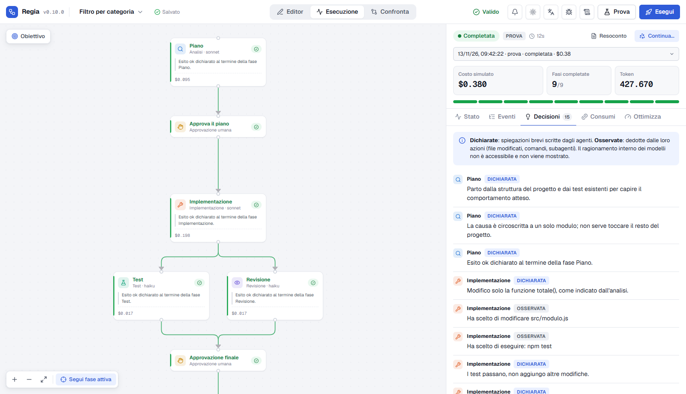

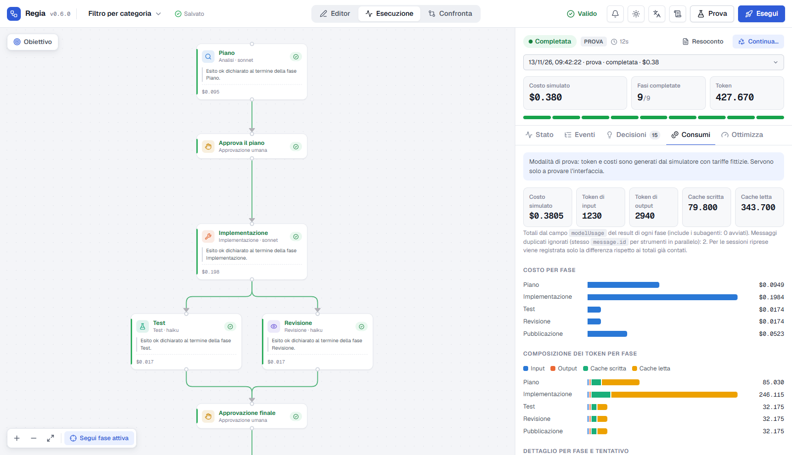

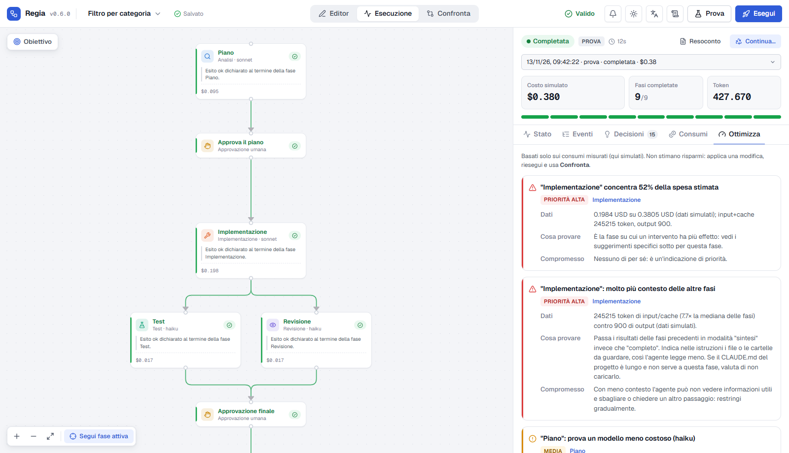

**Report**: the button at the top of the panel opens a Markdown summary of the run, to copy (for example into a pull request description) or download as a `.md` file. It includes status, duration, estimated cost, goal and, for each phase, the result, declared decisions, files edited, attempts and models, plus the interventions with your comments.

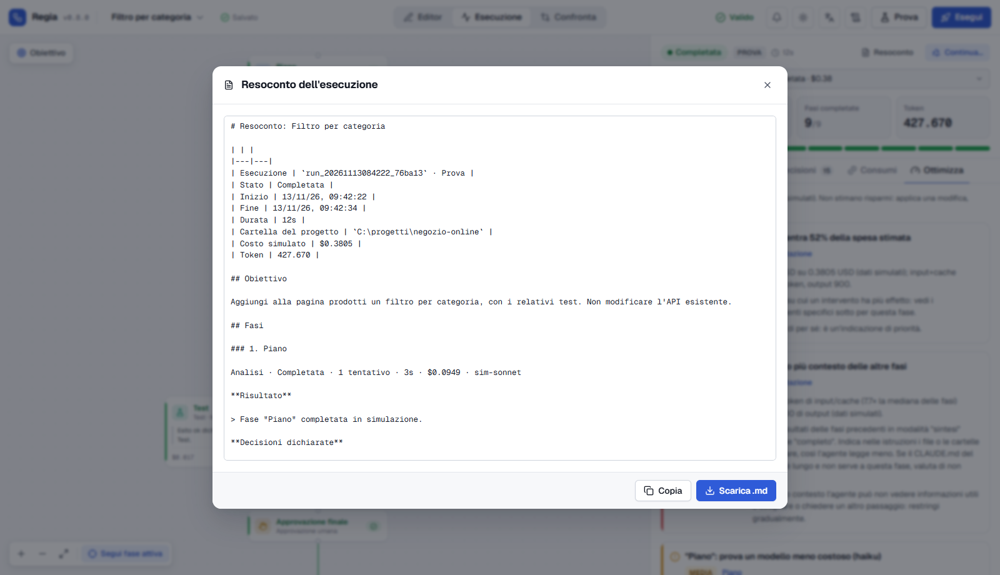

> **Costs are estimates** computed by the SDK at list prices. With an API key, the actual cost is in the Console; with a claude.ai subscription, usage counts against your plan limits.

---

## 7. Improve: compare two runs

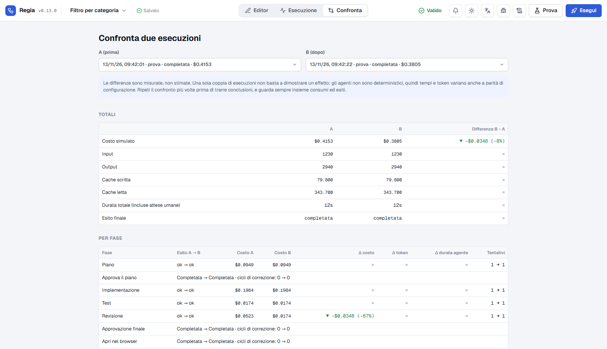

Change something (for example a cheaper model for the review), run again and open **Compare**: you see the measured differences in cost, tokens, time and outcome, and what changed in the configuration. A single pair of runs is not enough to draw conclusions: agents are not deterministic.

---

## 8. Add phases to finished work: Continue

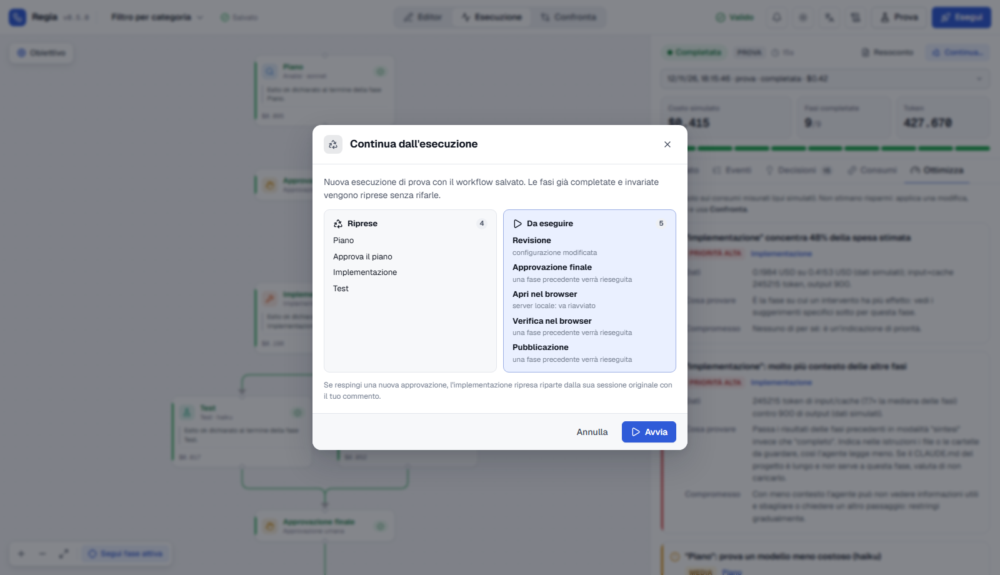

You finished a run and realize something was missing, for example preview, approval and publishing?

1. Add the phases in the editor and **save**.
2. Go to **Runs** and pick the finished run from the menu at the top of the panel.
3. **Continue…**: phases already done and unchanged are carried over with their results, without running them again; only new or changed phases run. The summary before starting tells you which ones and why.

**Resume** and **Continue…** are different: Resume carries on the same suspended or interrupted run, Continue… creates a new one with the current workflow.

### Syncing a feature with develop

The feature workflow is opened, worked on and closed. The backmerge from develop and the functional test that follows, maybe days later, are separate work that can be repeated every time develop moves: that is why they have their own preset, **Sync and verify**.

1. Create a workflow from the preset on the project folder, with the feature branch checked out. In the goal, name the branches, for example "Sync feature/orders with develop".
2. If the functional test needs the app, add a **Run app** phase suited to the project from the palette, before **Functional test**.
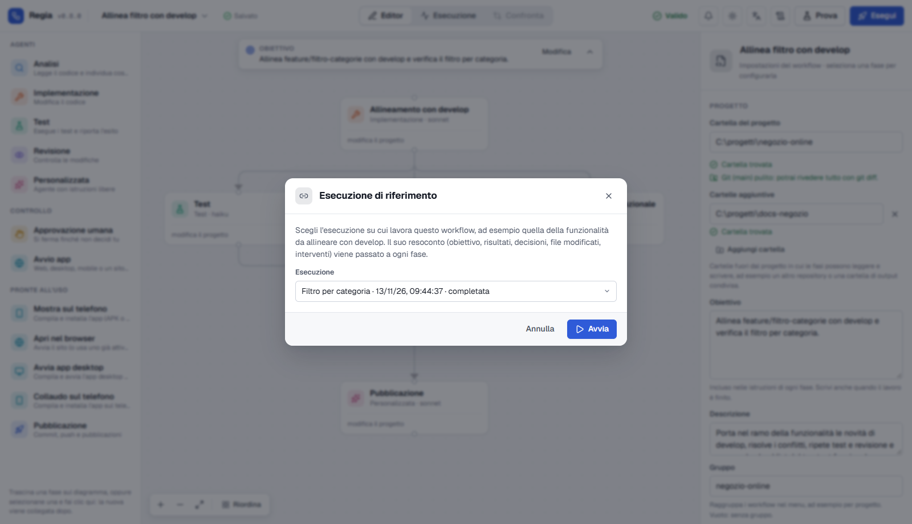

3. At start, Regia asks for the **reference run**: pick the feature's run. Its report (goal, results, decisions, changed files, interventions) reaches every phase. The agent resolves conflicts knowing what the feature was meant to do, and the functional test checklist starts from there.
4. The flow is:
   - **Sync with develop**: merges and resolves conflicts, declaring each choice; it stops and asks you when a conflict needs a product decision.
   - **Tests**, **Merge review** and **Functional test checklist**.
   - **Functional test**: you do it, following the checklist. If you reject, the fix is made on the branch and the checks are repeated.
   - **Publish** (push).

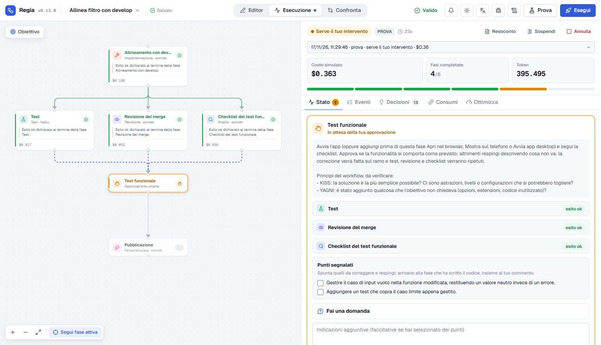

The reference run can be turned on for any workflow in the settings (**Reference run**) and is shown in the run's Status tab and in the report.

---

## 9. General rules

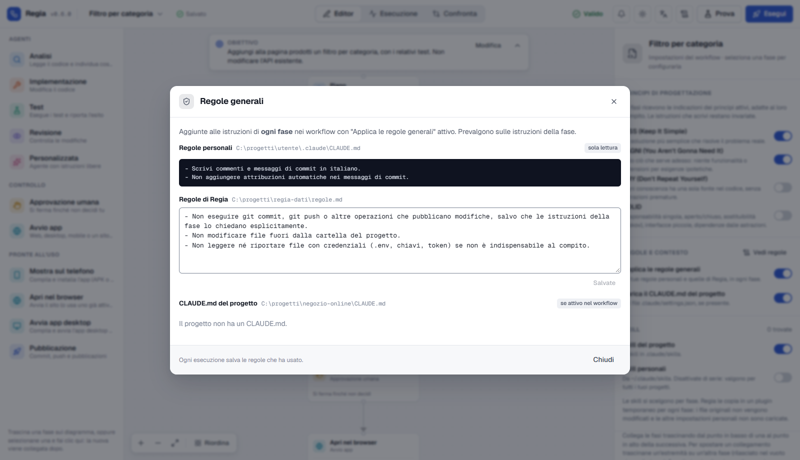

The **Rules** button shows the rules added to every agent's instructions:

- your **personal rules** (`~/.claude/CLAUDE.md`), read and never modified;
- **Regia's rules**, editable here (by default: no commit or push unless the phase asks for it, no changes outside the project and the additional folders, no reading credential files);
- the **project's CLAUDE.md**, if you enable the option in the workflow.

Each run stores the rules it used.

### Design principles

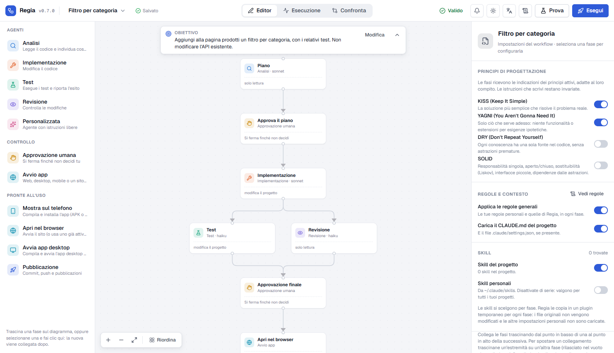

In the workflow settings (and when creating it) the **Design principles** section has a switch for each principle; they can be combined:

- **KISS** (Keep It Simple): the simplest solution that solves the real problem;
- **YAGNI** (You Aren't Gonna Need It): no features or extensions for hypothetical needs;
- **DRY** (Don't Repeat Yourself): a single source for every piece of knowledge, without premature abstractions;
- **SOLID**: single responsibility, open/closed, substitutability, small interfaces, depending on abstractions.

Each phase receives guidance suited to its type: analysis proposes the solution that fits the principle, implementation applies it, tests and review check it. Approvals show a checklist to go through. The instructions you write in the phases are left untouched: the guidance is added at run time, and turning the switch off removes it. In each phase's inspector, below the instructions, you can read what will be added.

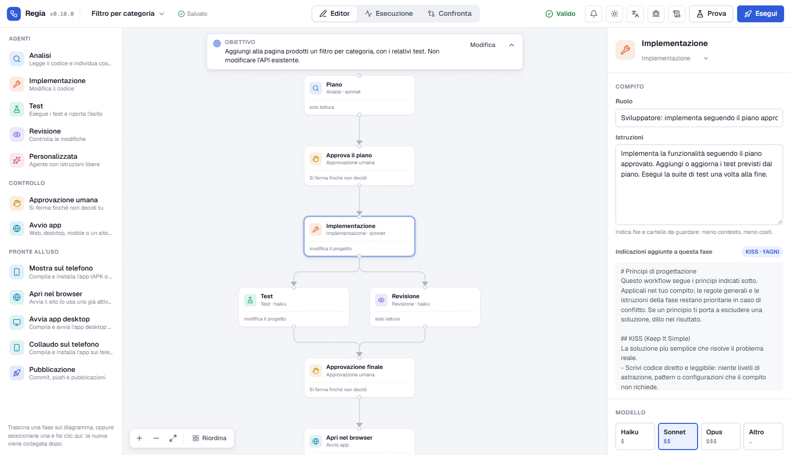

The run log lists the principles applied.

### Skills

Agent phases can use Claude Code **skills**: procedures written in a `SKILL.md` file (for example "publish a blog post" or "SEO check before release").

- **Where Regia looks**: in the project's `.claude/skills/` and `.agents/skills/` folders (on by default; the latter is also used by other tools such as Codex, Junie and Copilot) and among your personal skills in `~/.claude/skills/`, subfolders included (turn them on in the workflow settings, **Skills** section).
- **For each phase**, **Skills** section: *None* (default), *All* from the active sources, or *Selected* from a list with name, description and source. The phase box on the diagram shows how many skills it has.
- **During a run** the agent loads a skill only when it needs it; the events show the available skills, which one was used and the decision "Used the skill …". Skill instructions use tokens like the rest of the context.
- If a selected skill can no longer be found, validation warns you and the phase runs without it.

---

## 10. Organizing workflows, theme and language

- **Groups**: each workflow can belong to a group, for example its project. When you create one, the suggested group is the project folder name; you can also change it in the workflow settings. The menu with the workflow name, at the top left, lists workflows by group and has a search (Enter opens the first result).
- **Manage workflows…** (from the same menu): search, collapsible groups, and for each workflow open, rename, move to a group, duplicate, delete. Use the checkboxes to move or delete several workflows at once. A group can be renamed or removed (its workflows are kept, ungrouped). Deleting a workflow keeps its runs unless you choose to delete them; runs still in progress are never touched.
- **Sounds**: the bell at the top right (see [Step in when needed](#5-step-in-when-needed)).
- **Theme**: button at the top right, Match system / Light / Dark. **Language**: the button next to it. Both choices are remembered.

## 11. Common problems

| Problem | What to do |
|---|---|
| "Run" is disabled | The workflow has errors (badge at the top) |
| No login detected | Run `claude` once and sign in, or set `ANTHROPIC_API_KEY` before `npm start` |
| The app does not start or is never ready | Read the reason in the intervention request: command exited with an error, expected text never appeared, address not responding, Node version, dependencies, port in use. Use the suggested buttons or fix the command or the "Ready when" criterion in the phase |
| The run shows as "Interrupted" | Regia was closed while it was active: open it and use **Resume** |
| Spending is close to the limit | Raise the limit in the workflow settings or check the Optimize tab |

For details on usage accounting, permissions, stored data and known limits: [technical details](technical-details.md).
