# Regia manual

*[Leggi in italiano](manuale.md)*

Regia lets AI agents work on your project along a path you design: analysis, implementation, testing, review, browser preview, approval, publishing. While they work, the diagram shows what they are doing, what they decide and how much they use, and you step in when needed.

The interface is available in English and Italian: switch it from the languages menu at the top right. This manual uses the English labels; the screenshots show the Italian interface, taken in **dry-run mode** (simulated agents, no cost). Each workflow also has an **agent language** (settings → Run), which sets the language of the instructions sent to the agents.

---

## 1. Start

Once:

```bash
git clone https://github.com/DoctorB/regia.git
cd regia
npm install
```

Every time:

```bash
npm start
```

Open **http://127.0.0.1:4317** and keep the terminal open while you use Regia. Closing it also stops any run in progress.

**Systems**: Windows, macOS and Linux. iOS apps need a Mac with Xcode (see [iOS apps on a Mac](#ios-apps-on-a-mac)).

**Requirements**: Node.js 20 or later. Real runs need [Claude Code](https://docs.claude.com/en/docs/claude-code) with an active login (check with `claude auth status`), or the `ANTHROPIC_API_KEY` environment variable. You don't need to open Claude Code: Regia uses its credentials.

---

## 2. Create a workflow

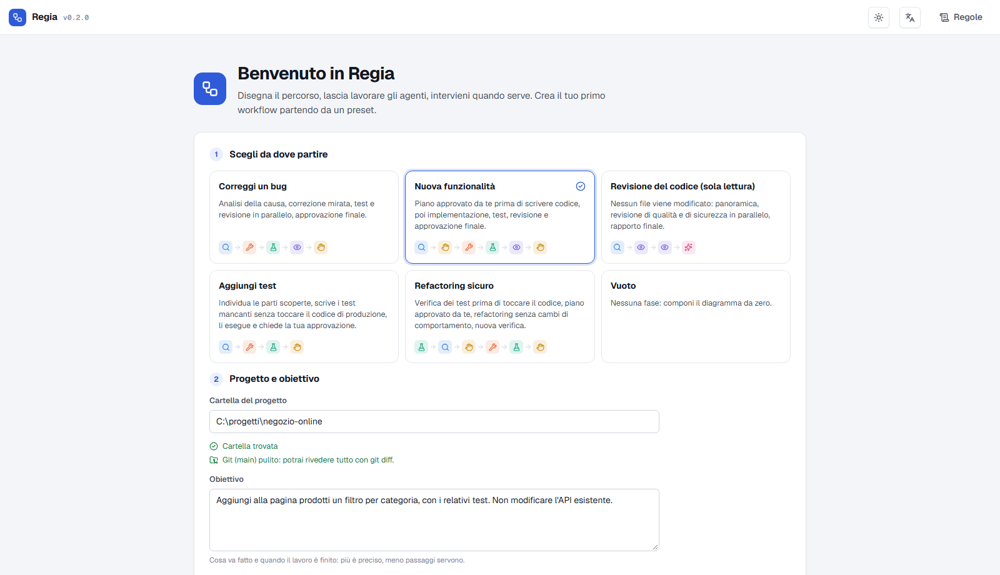

1. On first start you see the welcome screen; later, open the menu with the workflow name at the top left → **New workflow…**. Pick a preset: *Fix a bug*, *New feature*, *Code review (read-only)*, *Add tests*, *Safe refactoring* or *Empty*.
2. Enter the **project folder**. Regia checks whether it is a git repository and whether it has uncommitted changes.
   > Before a real run, **commit or stash** your changes: you can then review the agents' work with `git diff` and undo it with `git checkout .`.
3. Write the **goal**: what needs to be done and when it counts as finished. The more precise it is, the fewer rounds it takes.

---

## 3. Customize the phases

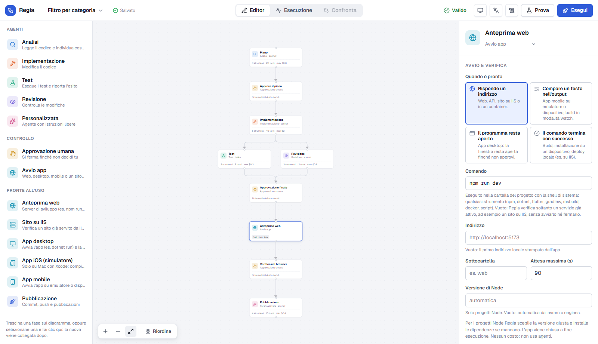

- **Add** phases from the palette on the left: drag them onto the diagram, or click. If a phase is selected, the new one is connected right after it. **Arrange** lays the diagram out top to bottom.
- **Connect** two phases by dragging from the bottom handle of one to the top handle of the other; select a connection or a phase and press **Delete** to remove it.
- **Configure** the selected phase in the right panel:
  - *Instructions*: what it must do, ideally naming the files to look at.
  - *Model*: Haiku ($) for simple tasks (tests, checks), Sonnet ($$) as the balanced choice, Opus ($$$) for the hardest tasks.
  - *Tools*: turn on only those needed. Tools with a pencil icon edit files or run commands.
  - *Max turns* and *Max spend*: safety caps.
- With no phase selected, the panel shows the **workflow settings**: folder, goal, spending limit per run, phases in parallel, rules.
- The indicator at the top tells you whether the workflow is **Valid**: click it to see errors and warnings and jump to the phase concerned. Errors block the start. **Save** appears when there are changes (also `Ctrl+S`).

### Phase types

| Phase | Purpose |
|---|---|
| Analysis, Implementation, Test, Review, Custom | Work done by an agent |
| **Human approval** | The workflow waits until you approve or reject |
| **Run app** | Regia starts the app so you can check it: web, desktop, mobile, or it checks a site already served by IIS |
| **Publishing** (ready-made phase) | Commit, push and any releases or GitHub Actions. Place it after an approval |

---

## 4. Try first, then run for real

- **Dry run**: runs everything with simulated agents. Use it to check the flow and the interactions, for free.
- **Run**: a real run. It shows a summary (authentication, models, phases that can edit files, local commands, spending limit) and starts only after you confirm.

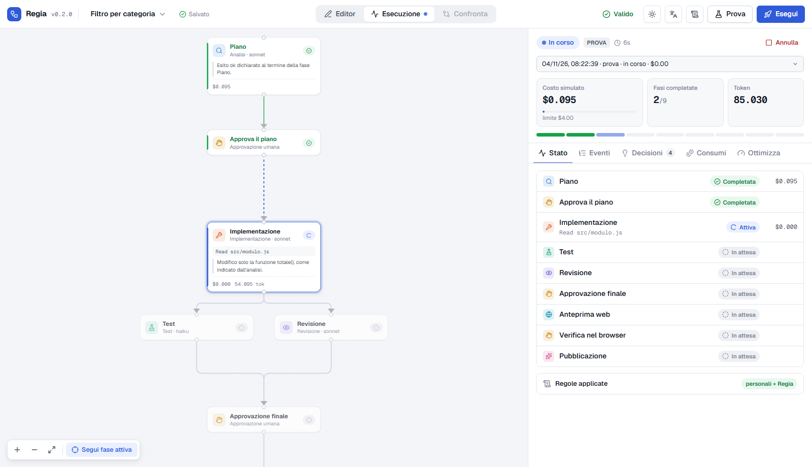

On the diagram each phase shows its state (waiting, active, completed, failed, blocked, waiting for you), what it is doing and the last declared decision; **Follow active phase** keeps the running phase in view. At the top of the panel you find cost and spending limit, completed phases and a progress bar (click a segment to select that phase). **Cancel** stops everything.

---

## 5. Step in when needed

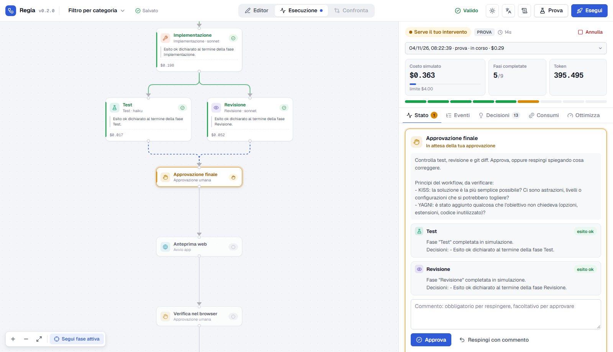

When the workflow stops, the **Status** tab shows what is needed:

- **Approval**: read the summaries of the previous phases and check the project (`git diff`), then **Approve** or **Reject with comment**: the phase that produced the work resumes where it left off with your comment, and tests and review run again.
- **Failed or blocked phase**: **Retry from scratch**, **Resume session** (with a message for the agent), **Skip phase** or **Cancel run**.

### Checking the app: web, desktop, mobile

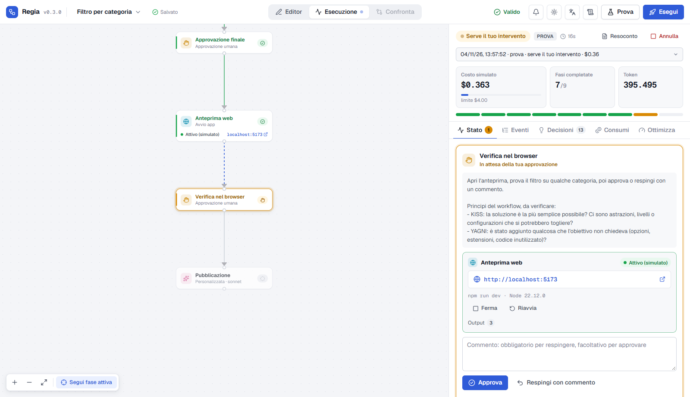

Regia is not tied to a technology: agents work with the project's own tools (npm, dotnet, msbuild, gradle, flutter, Xcode, docker…) through the Bash tool. The **Run app** phase lets you see the result before approving. It runs any command in the project folder and waits until the app is ready, according to the criterion chosen in **Ready when**:

| Criterion | Examples |
|---|---|
| **An address responds** | Web dev server (`npm run dev`, `dotnet watch`), API, container. **With no command** it only checks a site that is already running, for example on **IIS**: Regia neither starts nor stops it |
| **A text appears in the output** | Mobile app on an emulator or device (`flutter run` → "Flutter run key commands"), build in watch mode |
| **The program stays open** | Desktop app (`dotnet run`, `npm run electron`, `python app.py`): the window stays open until you approve |
| **The command succeeds** | Build, install on a device (`gradlew installDebug`), iOS app in the simulator (`xcodebuild` + `xcrun simctl`), local deploy to IIS (`msdeploy`, PowerShell script) |

In the palette, among the **ready to use** phases, you'll find **Web preview**, **Site on IIS**, **Desktop app**, **iOS app (simulator)** and **Mobile app** already set up: just adjust command and address.

The approval request shows the link (if any), the status, the last output lines and the Stop / Restart buttons. The app is closed when the run ends; after a correction requested in an approval it is restarted, so you check the updated version.

For Node projects (with a `package.json`) Regia does more: it picks the required Node version (`.nvmrc`, `engines`), installs dependencies if missing and, if the right version is not installed, offers to install it.

### iOS apps on a Mac

On a Mac with **Xcode** (and its command line tools: `xcode-select --install`) Regia also orchestrates iOS apps: Regia is installed and started just as on Windows.

- **Agents**: they build and run tests with `xcodebuild` through Bash; enable Bash in the phases that need it. Builds are slow: raise the maximum turns and the spending limit of those phases.
- **Ready-made iOS app (simulator) phase**: builds for the simulator, boots it, installs and opens the app, with the "The command succeeds" criterion (waits up to 15 minutes). Before using it, adjust three values in the command: the **scheme** (`-scheme App`), the **app name** (`App.app`) and the **bundle id** (`com.example.App`); change the simulator too if needed (`iPhone 16`, list them with `xcrun simctl list devices`). For a CocoaPods workspace add `-workspace AppName.xcworkspace`.
- **Other frameworks**: Flutter → `flutter run -d "iPhone 16"` with expected text `Flutter run key commands`; React Native → `npx react-native run-ios` with "The command succeeds"; Expo → `npx expo run:ios` with expected text `Logs for your project`.
- **After the phase** add an **Approval**: check the app in the simulator and decide.
- **Physical device, TestFlight, App Store**: you need an Apple Developer account, certificates and profiles already set up on the Mac; Regia and the agents use the existing ones and don't create them. The first time, macOS may ask for permissions for Xcode or the simulator: accept them by hand.

---

## 6. Understand what happened

A run's panel has five tabs:

| Tab | What you find |
|---|---|
| **Status** | Pending interventions, running servers, applied rules, phase summary |
| **Events** | Everything that happens, filterable by type; click a phase on the diagram to see only its events |
| **Decisions** | Short explanations written by the agents (*declared*) or inferred from their actions (*observed*). The models' internal reasoning is not shown |
| **Usage** | Tokens, cache and estimated cost per phase, agent and model |
| **Optimize** | Where the spending concentrates and what to try, each with its possible quality trade-off |

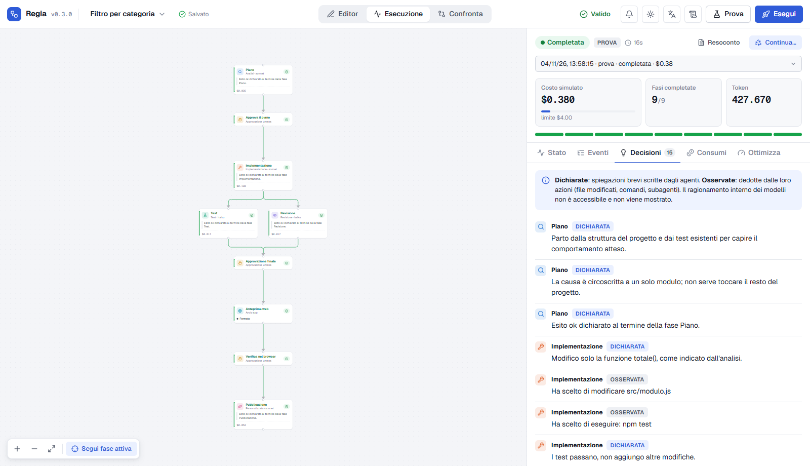

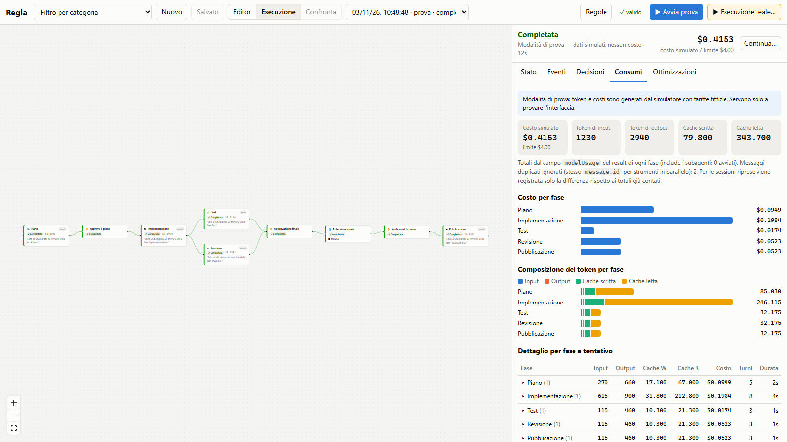

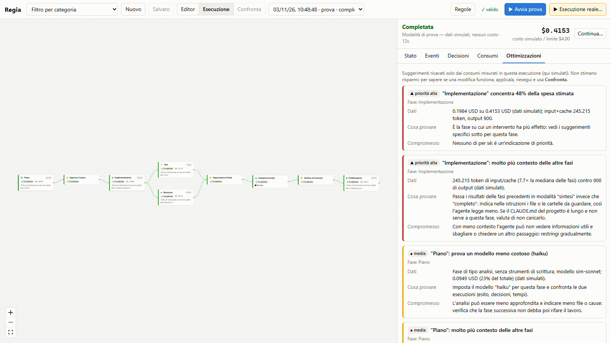

> **Costs are estimates** computed by the SDK at list prices. With an API key, the actual cost is in the Console; with a claude.ai subscription, usage counts against your plan limits.

---

## 7. Improve: compare two runs

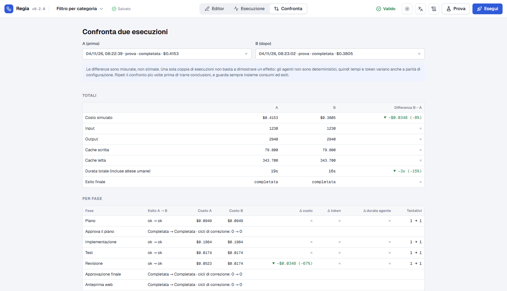

Change something (for example a cheaper model for the review), run again and open **Compare**: you see the measured differences in cost, tokens, time and outcome, and what changed in the configuration. A single pair of runs is not enough to draw conclusions: agents are not deterministic.

---

## 8. Add phases to finished work: Continue

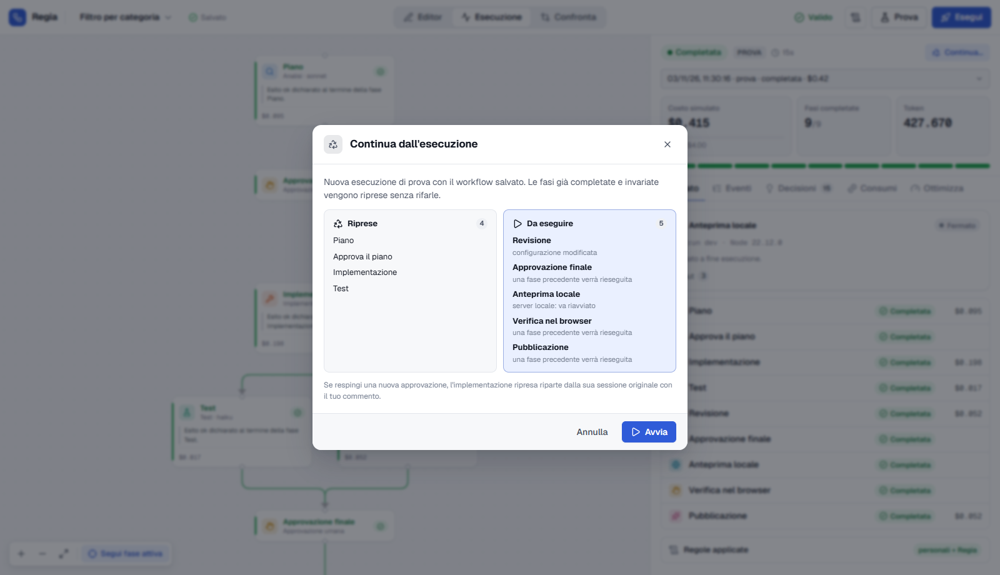

You finished a run and realize something was missing, for example preview, approval and publishing?

1. Add the phases in the editor and **save**.
2. Go to **Runs** and pick the finished run from the menu at the top of the panel.
3. **Continue…**: phases already done and unchanged are carried over with their results, without running them again; only new or changed phases run. The summary before starting tells you which ones and why.

---

## 9. General rules

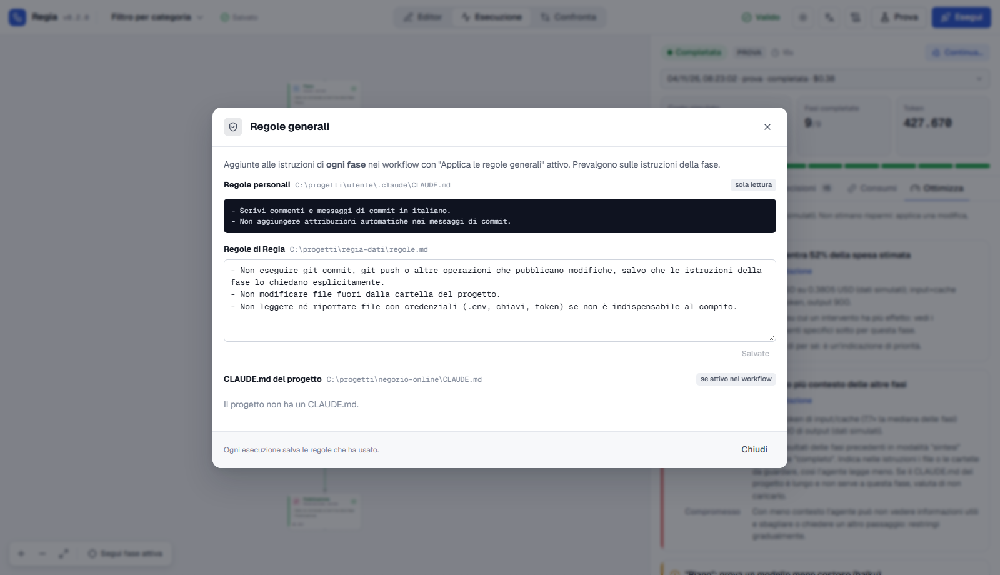

The **Rules** button shows the rules added to every agent's instructions:

- your **personal rules** (`~/.claude/CLAUDE.md`), read and never modified;
- **Regia's rules**, editable here (by default: no commit or push unless the phase asks for it, no changes outside the project, no reading credential files);
- the **project's CLAUDE.md**, if you enable the option in the workflow.

Each run stores the rules it used.

### Skills

Agent phases can use Claude Code **skills**: procedures written in a `SKILL.md` file (for example "publish a blog post" or "SEO check before release").

- **Where Regia looks**: in the project's `.claude/skills/` folder (on by default) and among your personal skills in `~/.claude/skills/`, subfolders included (turn them on in the workflow settings, **Skills** section).
- **For each phase**, **Skills** section: *None* (default), *All* from the active sources, or *Selected* from a list with name, description and source. The phase box on the diagram shows how many skills it has.
- **During a run** the agent loads a skill only when it needs it; the events show the available skills, which one was used and the decision "Used the skill …". Skill instructions use tokens like the rest of the context.
- If a selected skill can no longer be found, validation warns you and the phase runs without it.

---

## 10. Organizing workflows, theme and language

- **Groups**: each workflow can belong to a group, for example its project. When you create one, the suggested group is the project folder name; you can also change it in the workflow settings. The menu with the workflow name, at the top left, lists workflows by group and has a search (Enter opens the first result).
- **Manage workflows…** (from the same menu): search, collapsible groups, and for each workflow open, rename, move to a group, duplicate, delete. Use the checkboxes to move or delete several workflows at once. A group can be renamed or removed (its workflows are kept, ungrouped). Deleting a workflow keeps its runs unless you choose to delete them; runs still in progress are never touched.
- **Theme**: button at the top right, Match system / Light / Dark. **Language**: the button next to it. Both choices are remembered.

## 11. Common problems

| Problem | What to do |
|---|---|
| "Run" is disabled | The workflow has errors (badge at the top) |
| No login detected | Run `claude` once and sign in, or set `ANTHROPIC_API_KEY` before `npm start` |
| The app does not start or is never ready | Read the reason in the intervention request: command exited with an error, expected text never appeared, address not responding, Node version, dependencies, port in use. Use the suggested buttons or fix the command or the "Ready when" criterion in the phase |
| The run shows as "Interrupted" | Regia was closed while it was active: open it and use **Continue…** |
| Spending is close to the limit | Raise the limit in the workflow settings or check the Optimize tab |

For details on usage accounting, permissions, stored data and known limits: [technical details](technical-details.md).
