# Manuale di Regia

Regia fa lavorare agenti AI su un tuo progetto seguendo un percorso che disegni tu: analisi, implementazione, test, revisione, anteprima nel browser, approvazione, pubblicazione. Mentre lavorano, vedi sul diagramma cosa stanno facendo, cosa decidono, quanto consumano, e intervieni quando serve.

Le immagini di questo manuale sono prese in **modalità di prova**: agenti simulati, nessun costo.

---

## 1. Avvio

Una volta sola:

```bash
git clone https://github.com/DoctorB/regia.git
cd regia
npm install
```

Ogni volta:

```bash
npm start
```

Apri **http://127.0.0.1:4317** e lascia aperto il terminale finché usi Regia. Chiudendolo si fermano anche le esecuzioni in corso.

**Requisiti**: Node.js 20 o superiore. Per le esecuzioni reali serve [Claude Code](https://docs.claude.com/en/docs/claude-code) con un login attivo (verifica con `claude auth status`), oppure la variabile `ANTHROPIC_API_KEY`. Non serve aprire Claude Code: Regia usa le sue credenziali.

---

## 2. Crea un workflow

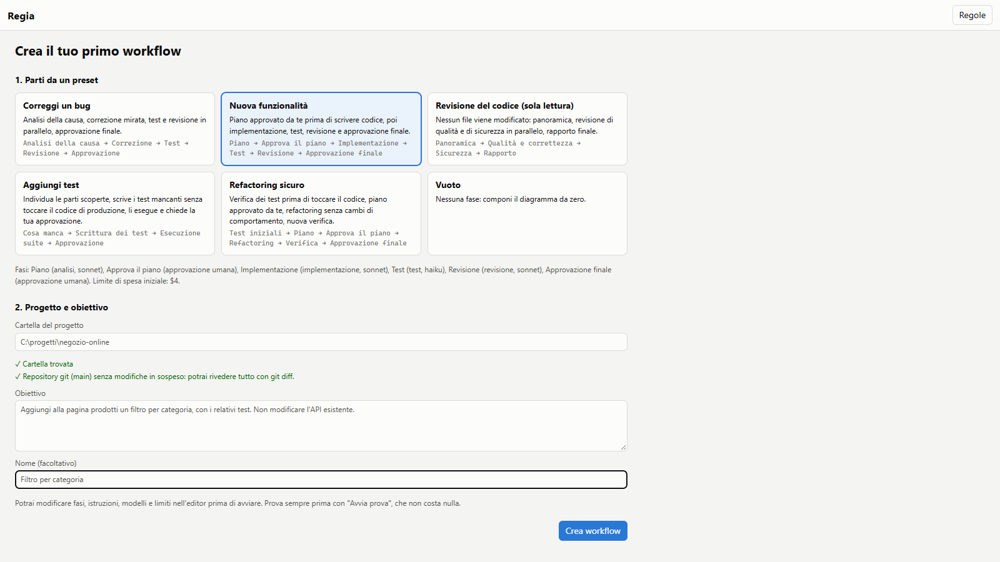

1. **Nuovo** → scegli un preset: *Correggi un bug*, *Nuova funzionalità*, *Revisione del codice* (sola lettura), *Aggiungi test*, *Refactoring sicuro* o *Vuoto*.
2. Indica la **cartella del progetto**. Regia controlla se è un repository git e se ci sono modifiche non salvate.
   > Prima di un'esecuzione reale fai **commit o stash** delle tue modifiche: così potrai rivedere il lavoro degli agenti con `git diff` e annullarlo con `git checkout .`.
3. Scrivi l'**obiettivo**: cosa va fatto e quando è finito. Più è preciso, meno passaggi servono.

---

## 3. Personalizza le fasi

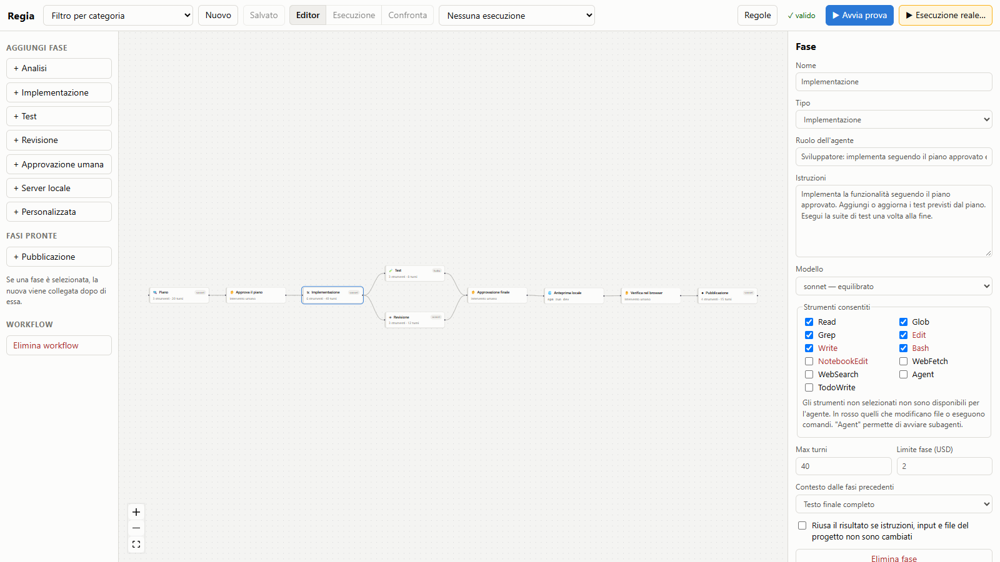

- **Aggiungi** fasi dalla palette a sinistra. Se una fase è selezionata, la nuova viene collegata subito dopo.
- **Collega** due fasi trascinando dal punto destro di una al punto sinistro dell'altra; seleziona un collegamento o una fase e premi **Canc** per eliminarli.
- **Configura** la fase selezionata nel pannello a destra:
  - *Istruzioni*: cosa deve fare, idealmente con i file da guardare.
  - *Modello*: `haiku` per compiti semplici (test, controlli), `sonnet` come scelta equilibrata, `opus` per i compiti più difficili.
  - *Strumenti consentiti*: solo quelli necessari. In rosso quelli che modificano file o eseguono comandi.
  - *Max turni* e *Limite fase*: tetti di sicurezza.
- Senza fasi selezionate il pannello mostra le **impostazioni del workflow**: cartella, obiettivo, limite di spesa per esecuzione, fasi in parallelo, regole.
- Il badge in alto dice se il workflow è **valido**; gli errori bloccano l'avvio. **Salva** con il pulsante o `Ctrl+S`.

### Tipi di fase

| Fase | A cosa serve |
|---|---|
| Analisi, Implementazione, Test, Revisione, Personalizzata | Lavoro svolto da un agente |
| **Approvazione umana** | Il workflow si ferma finché non approvi o respingi |
| **Server locale** | Regia avvia il server di sviluppo (es. `npm run dev`) per farti vedere il risultato nel browser |
| **Pubblicazione** (fase pronta) | Commit, push ed eventuali pubblicazioni o GitHub Actions. Mettila dopo un'approvazione |

---

## 4. Prova, poi esegui

- **▶ Avvia prova**: esegue tutto con agenti simulati. Serve a controllare il percorso e le interazioni, gratis.
- **▶ Esecuzione reale…**: mostra un riepilogo (autenticazione, modelli, fasi che possono modificare file, comandi locali, limite di spesa) e parte solo dopo la tua conferma.

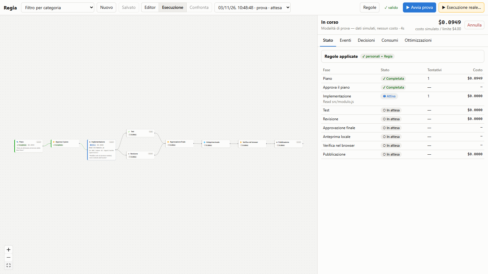

Sul diagramma ogni fase mostra lo stato (in attesa, attiva, completata, fallita, bloccata, in attesa di te), cosa sta facendo e l'ultima decisione dichiarata. **Annulla** in alto a destra ferma tutto.

---

## 5. Intervieni quando serve

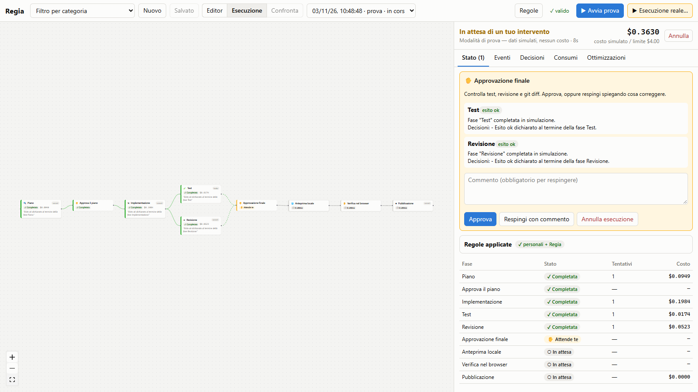

Quando il workflow si ferma, la scheda **Stato** mostra cosa serve:

- **Approvazione**: leggi le sintesi delle fasi precedenti e controlla il progetto (`git diff`), poi **Approva** oppure **Respingi con commento**: la fase che ha prodotto il lavoro riprende da dove era con il tuo commento, e test e revisione vengono rifatti.
- **Fase fallita o bloccata**: **Riprova da capo**, **Riprendi la sessione** (con un messaggio per l'agente), **Salta la fase** o **Annulla esecuzione**.

### Anteprima nel browser

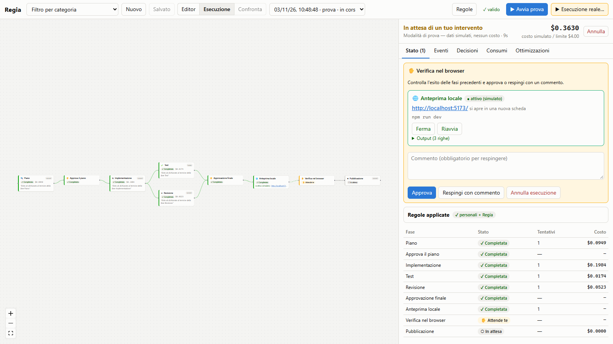

La fase **Server locale** avvia il server del progetto e mette il link nella richiesta di approvazione: aprilo, verifica, poi approva. Ferma e riavvia sono a portata di clic. Regia sceglie da sola la versione di Node richiesta dal progetto (`.nvmrc`, `engines`), installa le dipendenze se mancano e, se manca la versione di Node giusta, ti propone di installarla. Il server viene chiuso a fine esecuzione.

---

## 6. Capire cosa è successo

Il pannello di un'esecuzione ha cinque schede:

| Scheda | Cosa trovi |
|---|---|
| **Stato** | Interventi richiesti, server attivi, regole applicate, riepilogo delle fasi |
| **Eventi** | Tutto quello che succede, filtrabile per tipo; clicca una fase sul diagramma per vedere solo i suoi |
| **Decisioni** | Spiegazioni brevi scritte dagli agenti (*dichiarate*) o dedotte dalle loro azioni (*osservate*). Il ragionamento interno dei modelli non viene mostrato |
| **Consumi** | Token, cache e costo stimato per fase, agente e modello |
| **Ottimizzazioni** | Dove si concentra la spesa e cosa provare, ognuno con il possibile compromesso sulla qualità |

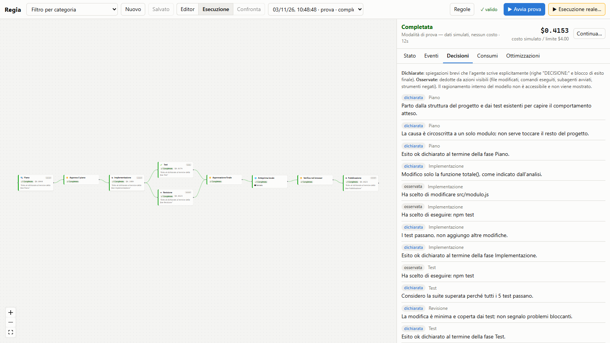

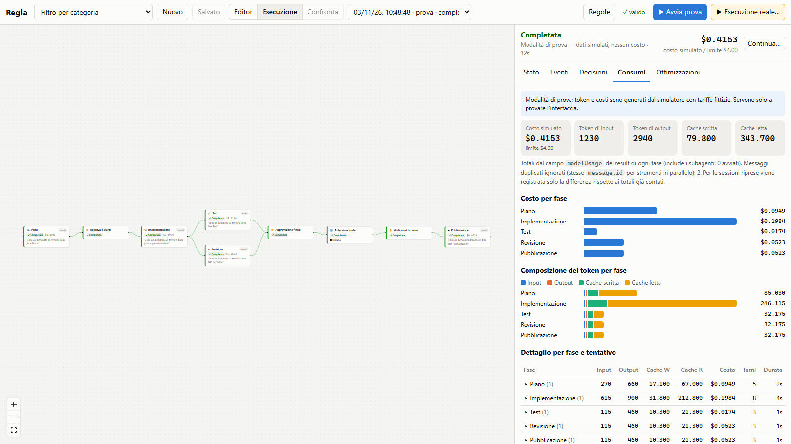

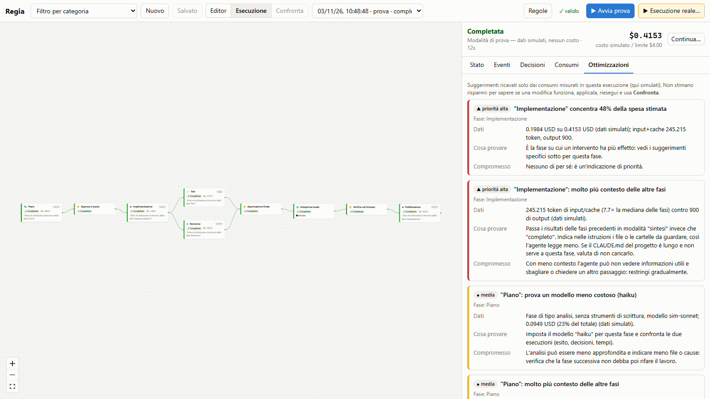

> **I costi sono stime** calcolate dal SDK a prezzi di listino. Con una chiave API il costo reale è nella Console; con un abbonamento claude.ai il consumo rientra nei limiti del piano.

---

## 7. Migliorare: confronta due esecuzioni

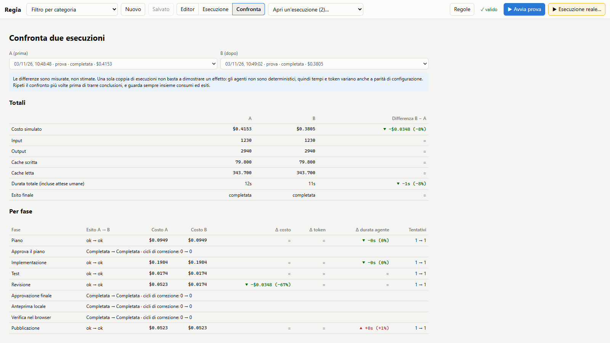

Cambia qualcosa (ad esempio un modello più economico per la revisione), riesegui e apri **Confronta**: vedi le differenze misurate di costo, token, tempi ed esiti, e cosa è cambiato nella configurazione. Una sola coppia di esecuzioni non basta a concludere: gli agenti non sono deterministici.

---

## 8. Aggiungere fasi a un lavoro già fatto: Continua

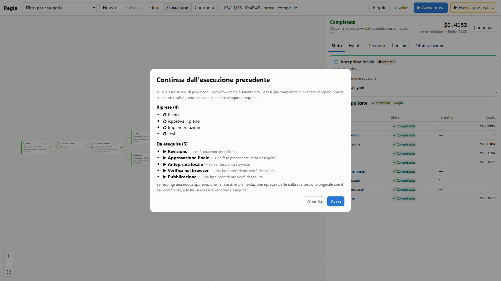

Hai completato un'esecuzione e ti accorgi che mancava qualcosa, ad esempio anteprima, approvazione e pubblicazione?

1. Aggiungi le fasi nell'editor e **salva**.
2. Apri l'esecuzione completata dal menu **Apri un'esecuzione…** in alto.
3. **Continua…**: le fasi già fatte e non modificate vengono riprese con i loro risultati, senza rifarle; vengono eseguite solo quelle nuove o cambiate. Il riepilogo prima dell'avvio ti dice quali e perché.

---

## 9. Regole generali

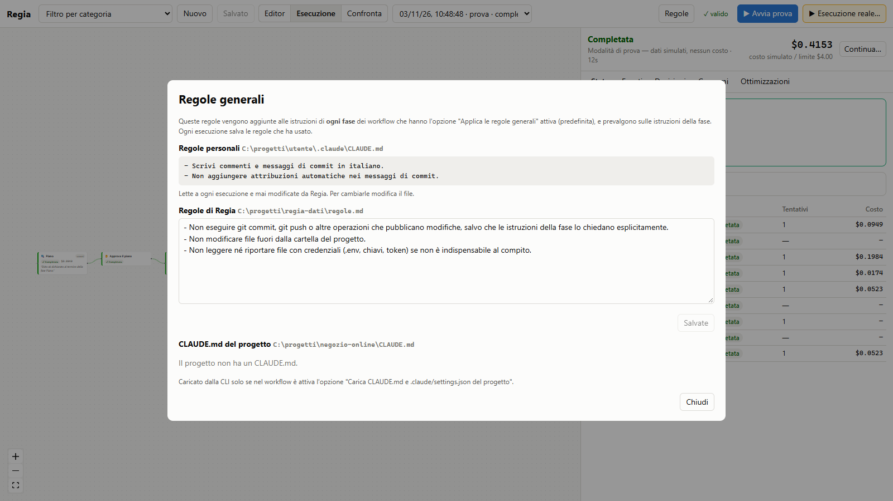

Il pulsante **Regole** mostra le regole aggiunte alle istruzioni di ogni agente:

- le tue **regole personali** (`~/.claude/CLAUDE.md`), lette e mai modificate;
- le **regole di Regia**, modificabili qui (di base: niente commit o push se la fase non lo chiede, niente modifiche fuori dal progetto, niente file con credenziali);
- il **CLAUDE.md del progetto**, se attivi l'opzione nel workflow.

Ogni esecuzione salva le regole che ha usato.

---

## 10. Problemi comuni

| Problema | Cosa fare |
|---|---|
| "Esecuzione reale" disattivato | Il workflow ha errori (badge in alto) |
| Nessun login rilevato | Esegui `claude` una volta e accedi, oppure imposta `ANTHROPIC_API_KEY` prima di `npm start` |
| Il server locale non parte | Leggi il motivo nella richiesta di intervento: versione di Node, dipendenze, porta occupata. Usa i pulsanti proposti oppure correggi il comando nella fase |
| L'esecuzione risulta "interrotta" | Regia è stato chiuso mentre era attiva: aprila e usa **Continua…** |
| La spesa è vicina al limite | Alza il limite nelle impostazioni del workflow o guarda la scheda Ottimizzazioni |

Per dettagli su conteggio dei consumi, permessi, dati salvati e limiti noti: [dettagli tecnici](dettagli-tecnici.md).
